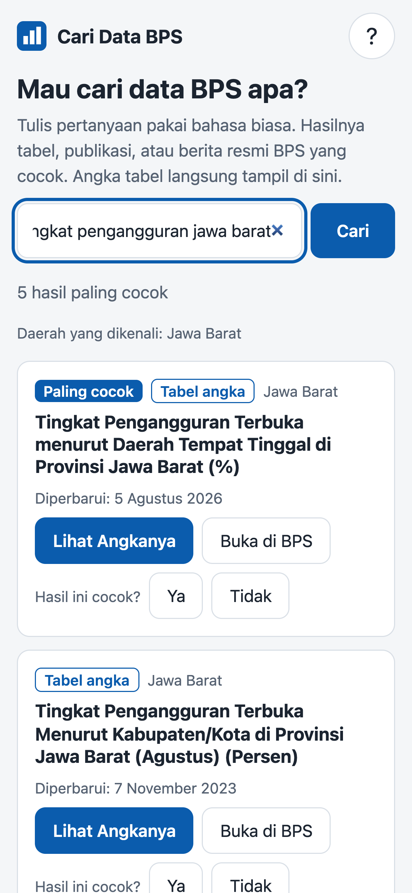
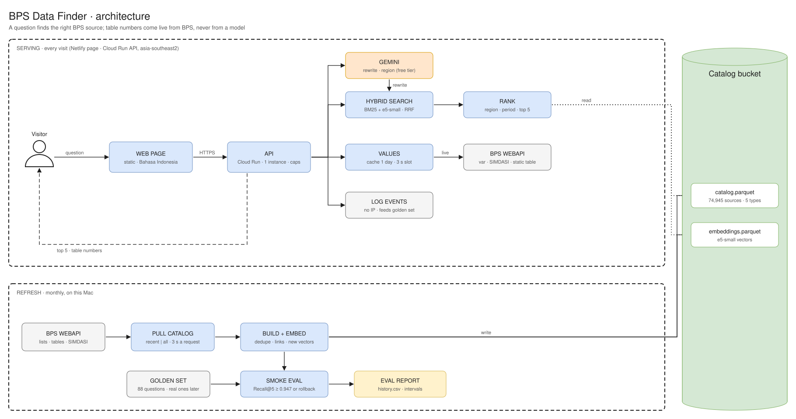
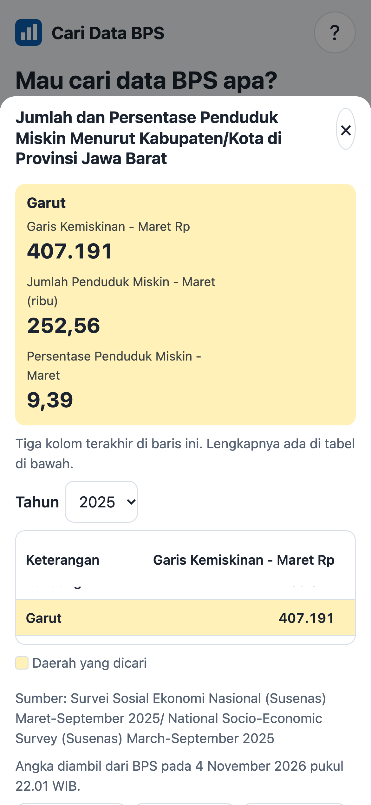

# Cari Data BPS

A search for Indonesian official statistics. Type a question in plain Bahasa Indonesia, such as "jumlah penduduk miskin kabupaten garut", and get the BPS table,
publication or press release that matches. For tables, the numbers show right there, copied from the BPS API.

**Live demo:** [cari-data-bps.netlify.app](https://cari-data-bps.netlify.app) (Bahasa Indonesia, free to use).
**Evaluation report:** [docs/eval-report.html](docs/eval-report.html) (download and open in a browser).

This is an independent project. It is not made by BPS and is not an official BPS product.



## Why
BPS publishes data on more than 540 separate websites: the national one, one per province and one per kabupaten/kota. One question can mean opening three sites,
and numbers inside publications are the hardest to find. This puts one search in front of the national and province catalogs and the Dalam Angka tables of
kabupaten/kota.

## How it works


- **Catalog.** About 75,000 items pulled from the BPS WebAPI: dynamic tables, static tables, Dalam Angka tables, publications (2025 and 2026) and press releases.
- **Search.** BM25 over titles, plus embeddings from `multilingual-e5-small`, fused with reciprocal rank fusion. The question's region is found by name and
  decides which sites' tables rank first; a month, quarter or year in the question boosts titles that name it.
- **Rewrite.** A language model (Gemini, free tier) turns everyday wording into BPS terms before the search. If it is unavailable, the search runs without it.
- **Numbers.** The language model never writes a number. A table's values are fetched from the BPS API when someone opens it and shown as BPS gives them,
  with the source and the time they were fetched.
- **Serving.** A FastAPI service on Cloud Run (one instance, so the 3 s spacing of BPS requests holds for everyone) and a static page on Netlify.



## How well it finds the right source
On 88 test questions, the right source is in the top 5 for **97.7%** (95% interval 94.3% to 100%), against about 19% for BPS's own search on the first 70
of them. Region ranking (+31.8 points) and the rewrite (+14.8 points) are clear gains. Embeddings on top of BM25 are not: that difference is within noise on
this set.

Read these numbers with the limits in mind: all 88 questions were written with Claude's help, no real user question is in the set yet, and labels came
from keyword filters plus pooled judging. [docs/eval-report.html](docs/eval-report.html) has the method comparison, intervals and every miss.

## Run it
```bash
uv sync
cp .env.example .env   # BPS_API_KEY (from webapi.bps.go.id) and GEMINI_API_KEY (aistudio.google.com)
uv run python -m src.ingestion.pull_catalog    # resumable, about 20 requests a minute
uv run python -m src.ingestion.build_catalog   # -> data/processed/catalog.parquet
uv run python -m evals.run_eval                # Recall@5 and MRR per method
uv run uvicorn app.main:app --port 8000        # /api/search?q=... and /api/value?doc_id=...
uv run pytest -q tests
npm install && npm run test:e2e                # the page in real Chrome against a fake API
```
The catalog and the BPS data are not in this repository: pull them with your own API key. Only a few small test fixtures (real API responses) are included.

## Data and terms
All statistics come from the BPS WebAPI and belong to Badan Pusat Statistik. Use of the API and the data follows BPS's own terms: keep your key private, respect the
rate limit, credit BPS. The page shows "This service uses the Badan Pusat Statistik (BPS) API."

## License
MIT for the code (see `LICENSE`). The data keeps BPS's terms.
